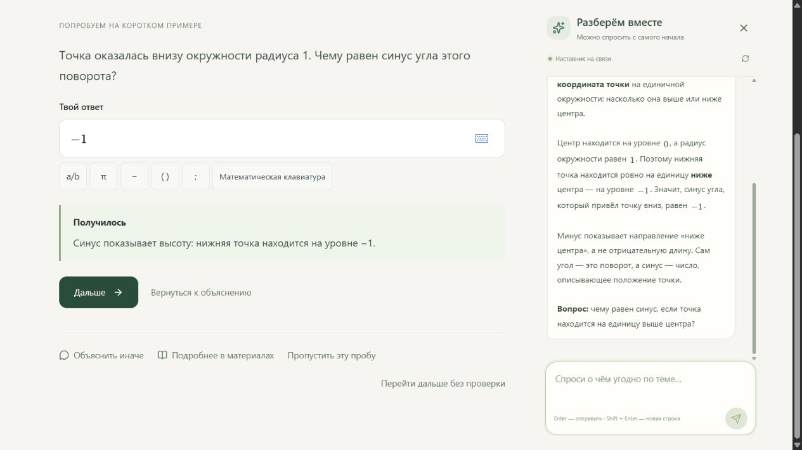

# Поле — тренажёр по математике

Подготовка к тригонометрическим уравнениям ЕГЭ: от объяснения синуса до самостоятельного решения полной задачи.

**[Открыть демонстрацию](https://myvibes.space)** · [Архитектура](docs/architecture.md) · [Развёртывание](deploy/README.md)



## Учебный маршрут

- **С основ:** короткие объяснения, рисунки, интерактивная окружность, обоснования и проверочные действия.
- **Вспомнить:** диагностическая проба и переход к нужной теме.
- **Решать:** тетрадь с текстом и формулами, подготовительные упражнения и возврат к своему решению.
- **Проверить себя:** новый вариант без подсказок. Обращение за помощью сохраняет самостоятельную часть работы.

Наставник обсуждает запись ученика, отвечает на выделенные фрагменты и предлагает материалы или подготовку. Точная проверка серий и корней отделена от комментария ИИ к ходу решения: модельный разбор не выдаётся за формальное доказательство.

## Возможности

Текстовый редактор Tiptap с формулами MathLive, математической клавиатурой и отменой изменений. Выделение → цитата в чате → адресный ответ. Библиотека связанных статей, учебные эпизоды и генератор вариантов по проверяемым шаблонам. Сохранение работ, переписки и учебного маршрута в SQLite; восстановление локальных черновиков при сбоях.

В размещённой версии каждому браузеру назначается отдельная сессия без регистрации. Другой браузер или очистка cookie создаёт новую историю; переноса между устройствами пока нет.

## Запуск

Нужен **Node.js 24.15 или новее в ветке 24**. Сервер использует встроенный SQLite и импорт TypeScript с удалением типов.

```sh
npm ci
npm run dev
```

Открыть `http://127.0.0.1:5173`. Команда запускает frontend и API; оба слушают loopback. Материалы и точная проверка работают независимо от доступности наставника.

Локальный провайдер по умолчанию — установленный и авторизованный Codex CLI. При необходимости задать `CODEX_BIN` путём к исполняемому файлу. Приложение не читает его auth-файлы. Для серверного API используются переменные окружения, описанные в [инструкции развёртывания](deploy/README.md). Ключи не передаются браузеру.

## Проверки

```sh
npm test
npm run build
node scripts/probe-codex.mjs --self-test
```

Тесты покрывают математические проверки, генерацию, переходы учебного маршрута, конфликты ревизий, сохранение попыток, ошибки провайдера и изоляцию посетителей. Проверки транспорта используют подмену модели; реальный доступ к провайдеру проверяется отдельно. `--live` у probe-скрипта делает настоящий запрос и расходует лимит аккаунта.

## Стек и границы

React · TypeScript · Tiptap · MathLive · Node.js · SQLite · Vite.

Это демонстрационный тренажёр с авторскими заданиями, а не официальный банк или автоматический экзаменатор. Проверяющий код поддерживает ограниченную запись рациональных кратных π и объединений серий. Неизвестный формат не объявляется ошибочным математическим решением. ИИ может ошибаться; просмотр урока не считается доказанным освоением навыка. Undo не сохраняется после перезагрузки, синхронизация между устройствами не реализована. Проверка на физических телефонах и с экранными дикторами ещё нужна.

Публичная версия содержит исходники, тесты и инструкции. Личные рабочие материалы, базы пользователей, переписка и конфигурация реальной инфраструктуры в неё не входят.
