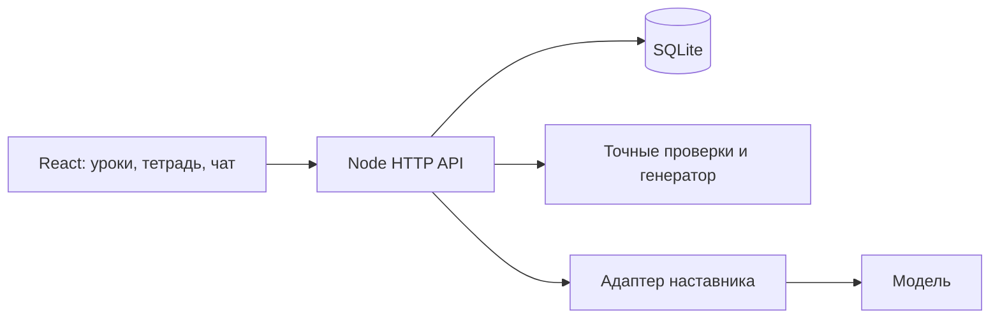

# Архитектура

## Поток данных

`src/App.tsx` координирует учебный маршрут, сохранение и переходы между тетрадью, подготовкой и разбором. `src/components` содержит отдельные учебные и диалоговые поверхности; `src/editor` интегрирует MathLive в Tiptap.

`server/index.mjs` проверяет запросы и режим работы. `server/store.mjs` хранит работы, снимки попыток, учебные события и текущий маршрут. `src/materials.ts` и `src/learning-content.ts` — авторское содержание; `server/learning.mjs` проверяет переходы.

## Математика и наставник

`server/root-checker.mjs` и `server/series.mjs` сравнивают поддерживаемые записи с точными эталонами. `server/generators.mjs` создаёт варианты из ограниченных семейств, а не просит модель сочинить условие и ответ. Тесты проверяют решения и исключение повторов.

Наставник получает текущую запись, вопрос, цитаты, ограниченную историю и доступные материалы. Он предлагает объяснения и переходы; не получает инструментов выполнения кода или доступа к файлам. Самостоятельный режим закрывает помощь на сервере, а не только скрывает кнопку. Разбор сдачи работает по сохранённому снимку, поэтому позднее редактирование не меняет материал уже запущенной проверки.

Наблюдаемые события попыток служат контекстом наставнику. Это не полноценная вероятностная модель навыков или забывания.

## Сохранение и изоляция

В hosted-режиме случайный секрет хранится в HttpOnly/Secure/SameSite cookie, в SQLite — его хеш. Публичный идентификатор сессии не является ключом доступа. Работы и события разделены по владельцу. Заголовок сессии связывает вкладку с текущей cookie; смена сессии не переносит прежний черновик другому посетителю.

Запись использует ревизии, обработку конфликтов и локальные аварийные копии. Сдача имеет идентификатор запроса, чтобы повторное получение результата не создавало новую попытку. Прерванные модельные запросы не повторяются автоматически.

## Провайдеры

- `codex`: локальный CLI app-server с отдельным временным контекстом и отключёнными инструментами.
- `openai`: серверный Responses API, ограниченные вход/ответ, время ожидания, дневной бюджет и один активный запрос.
- `cliproxy`: совместимый Responses endpoint на loopback. Его установка и авторизация не входят в этот репозиторий.

Настроенный провайдер ещё не означает рабочее подключение: статус подтверждается успешным запросом. Для размещённого сервиса следует использовать авторизацию и провайдера, допускающих такой сценарий. Ограничения стороннего прокси могут отличаться: например, его переводчик может не сохранять лимит выходных токенов.

## Масштаб

Реализация рассчитана на небольшую демонстрацию: один процесс и SQLite. Есть ограничения запросов, числа сессий и объёма работ. Нет распределённой очереди, пользовательских аккаунтов, восстановления доступа и доказанной устойчивости под большой нагрузкой.
